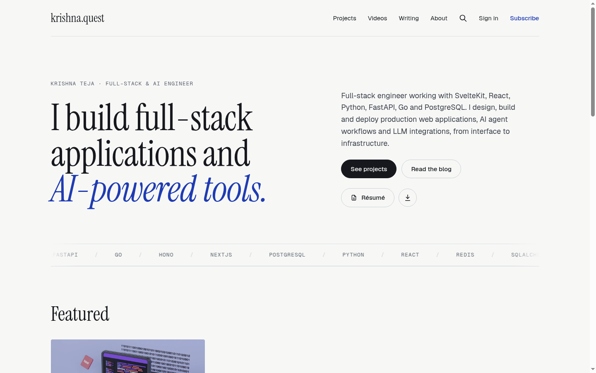
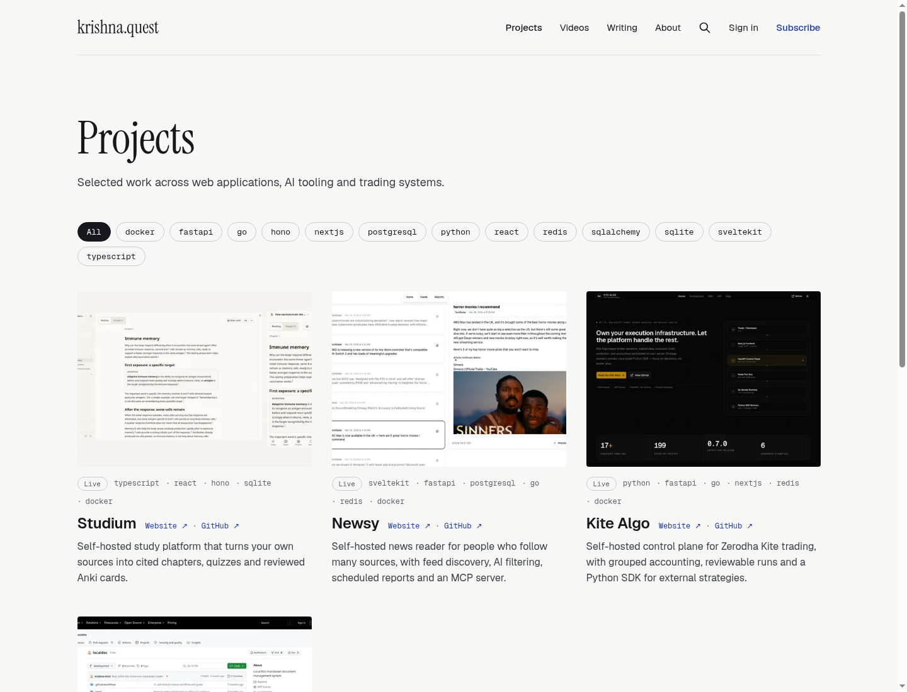
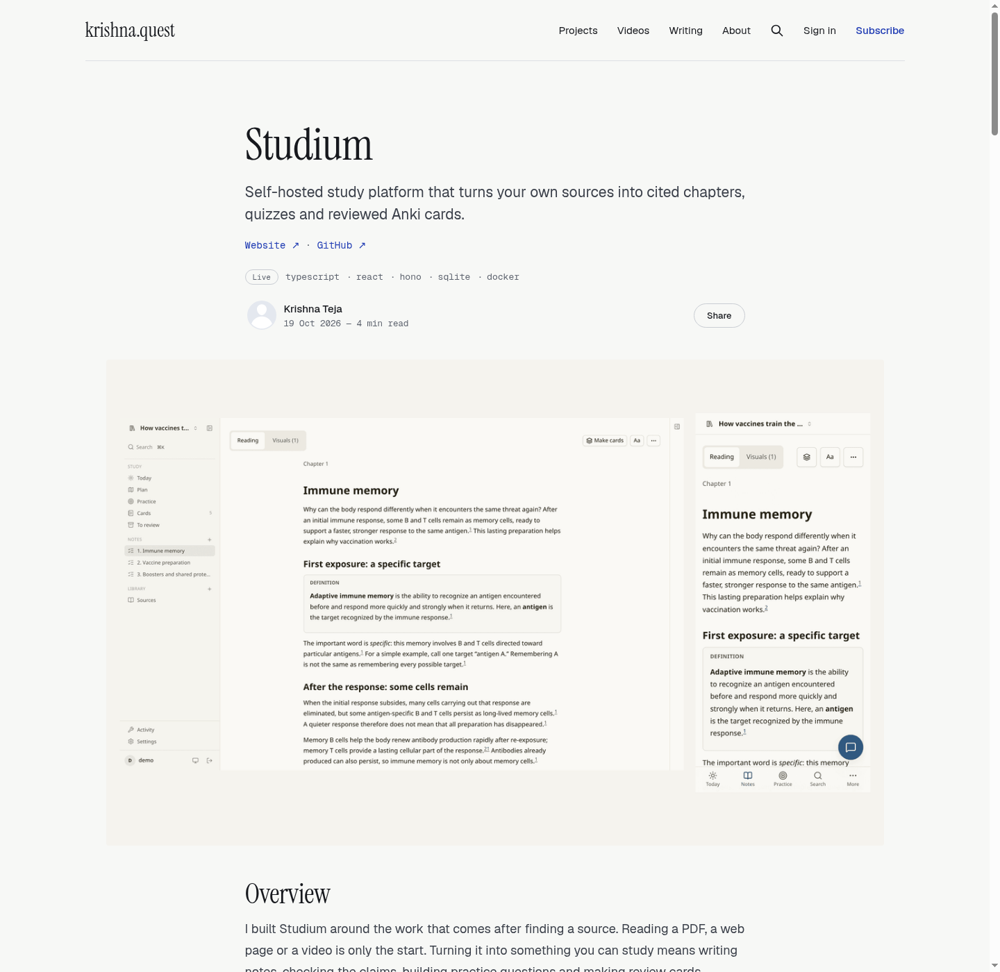
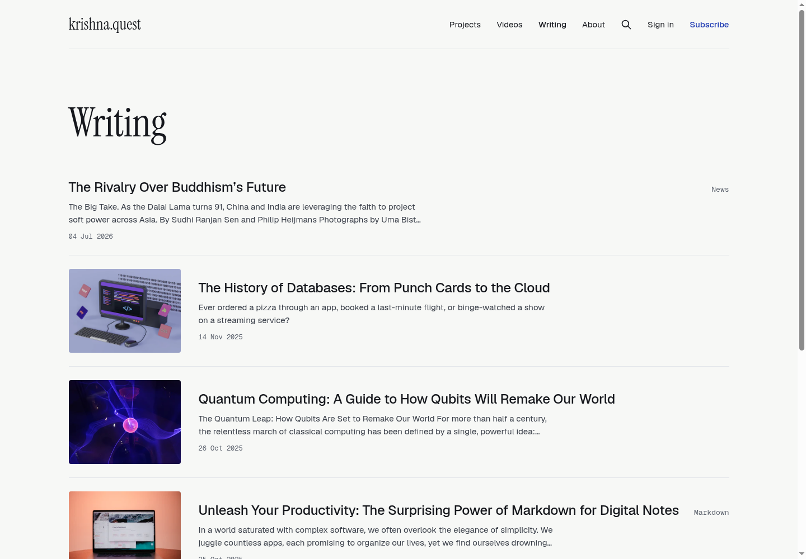
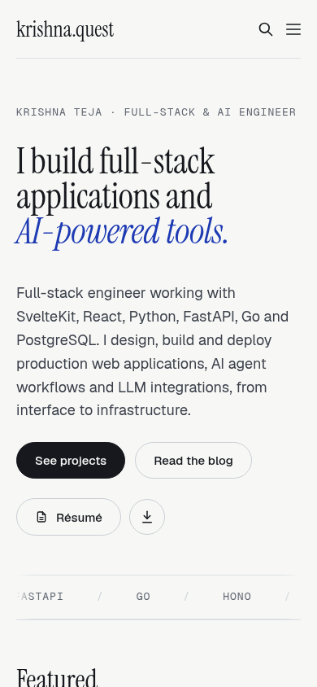

# Ghost Folio

A portfolio and blog theme for Ghost. It has a landing page, a projects collection with stack filters, a videos collection and a writing list. Forked from Ghost's Source theme.

Live demo: https://www.krishna.quest



## Features

- Landing page with a hero, featured and pinned posts, selected projects, the latest video, the latest writing and a newsletter sign-up.
- Projects collection with status and stack chips, and a client-side stack filter.
- Project case-study template with a feature image, links, status and stack.
- Videos collection.
- Writing list.
- Résumé button that links to a PDF.
- Footer links for GitHub, LinkedIn and email, set in the theme settings, plus RSS.
- Self-hosted fonts: Instrument Serif, Geist and Geist Mono.
- Subtle motion that is disabled when the visitor prefers reduced motion.
- Works without JavaScript. Content is visible and readable; the stack filter stays hidden and the scroll motion does not run.

## Screenshots

**Projects**



**Project case study**



**Writing**



**Mobile (390 px wide)**



## Install

1. Download `ghost-folio.zip` from the [Releases](https://github.com/krishna-vinci/ghost-folio/releases) page.
2. In Ghost Admin, go to Settings → Design & branding → Change theme → Upload, choose the zip, and activate it.
3. Upload `routes.yaml` in Settings → Labs → Routes. The routes set up the landing page at `/` and the `/projects/`, `/videos/` and `/blog/` collections.

**Ghost version.** `package.json` declares Ghost 5.0.0 or later in `engines`; this is inherited from Source. The theme has been tested on Ghost 6.71 only. Ghost 5 has not been tested.

## Content model

The theme uses Ghost tags, feature images and post settings. No custom fields are needed. Internal tags start with `#` and are hidden from readers.

| Element | How to set it | Effect |
|---|---|---|
| `#project` tag | Add the internal tag `#project` to a post. | The post appears on `/projects/` and in Selected projects on the home page. |
| `#stack-<name>` tag | For example `#stack-svelte`. | Shows a stack chip on the project card and page, and adds a filter button on `/projects/`. |
| `#status-live`, `#status-wip`, `#status-archived` | Add one status tag to a project. | Shows a status badge. |
| Feature image | Set the post's feature image. | Cover image on project and writing cards. |
| Feature image caption with links | Write the caption with links, for example `<a href="https://example.com">Website</a>`. | The links appear beside the project title and open in a new tab. |
| Feature this post | Turn on Feature this post in the post settings. | The post appears in the Featured section on the home page. |
| `#pinned` tag | Add the internal tag `#pinned` to one post. | The post appears as a large lead card in Featured. If several posts have the tag, the most recent is shown. |
| `#video` tag | Add the internal tag `#video` to a post. | The post appears on `/videos/` and as Latest video on the home page. Embed the video in the post body, for example with a YouTube embed card. |
| Post template | In the post settings, choose Project (`custom-project`) or Video (`custom-video`). | Uses the case-study layout or the video layout. |

## Theme settings

Set these in Ghost Admin under Settings → Design → Theme. An empty value uses the default or hides the element, as noted.

**Site-wide**

| Setting | Purpose |
|---|---|
| `signup_heading` | Newsletter heading. Defaults to the site title when empty. |
| `signup_subheading` | Newsletter description. Defaults to the site description when empty. |
| `resume_url` | Link to a résumé PDF. Upload the PDF in a post's File card. Empty hides the résumé buttons. |
| `contact_email` | Email address shown in the footer. Empty hides it. |
| `github_url` | GitHub profile link in the footer. Empty hides it. |
| `linkedin_url` | LinkedIn profile link in the footer. Empty hides it. |

**Homepage**

| Setting | Purpose |
|---|---|
| `hero_eyebrow` | Short line above the homepage heading. |
| `hero_heading` | Main heading, before the accented phrase. |
| `hero_heading_accent` | Accented phrase at the end of the heading. |
| `hero_intro` | Introduction below the heading. |
| `projects_intro` | Intro line on the `/projects/` page. Empty hides it. |
| `show_featured` | Show the Featured section. |
| `show_projects` | Show selected projects. |
| `projects_count` | Number of projects on the home page: `3` or `6`. Featured projects appear first. |
| `show_videos` | Show the latest three `#video` posts. |
| `show_writing` | Show the latest four posts that are not projects or videos. |
| `show_now` | Show the page with the slug `now`. |

**Post**

| Setting | Purpose |
|---|---|
| `show_post_metadata` | Show the author, publish date, reading time and sharing controls on posts. |
| `show_related_articles` | Show more articles below a post. |

## Routes

`routes.yaml` defines:

- `/` uses the home template.
- `/projects/` lists posts tagged `#project`, featured first, then newest. Use the Project post template for the case-study layout.
- `/videos/` lists posts tagged `#video`.
- `/blog/` is the writing collection, with posts at `/blog/{slug}/`.
- The `tag` and `author` taxonomies keep Ghost's default URLs.

If you are moving from an older site with posts at the root, see `redirects.example.yaml` for 301 redirect examples.

## Development

Requires Node.js 22.12 or later and pnpm 10.

```sh
pnpm install        # install dependencies
pnpm dev            # watch the source and rebuild assets
pnpm build          # build assets/built (CSS and JS)
pnpm zip            # build and write dist/ghost-folio.zip
npx gscan --fatal . # Ghost theme compatibility check
```

The zip task reads files as buffers (`encoding: false` in `gulpfile.js`). Without this, gulp 5 reads files as UTF-8 and corrupts the binary fonts and images.

Continuous integration runs the build and the gscan check on every push and pull request (see `.github/workflows/gscan.yml`).

## Credits and license

- Based on Ghost's Source theme, copyright Ghost Foundation, released under the MIT license.
- The fonts are licensed under the SIL Open Font License 1.1. The license files are in `assets/fonts/`.
- The theme code is released under the MIT license. See [LICENSE](LICENSE).
- Ghost Folio is not affiliated with the Ghost Foundation.
